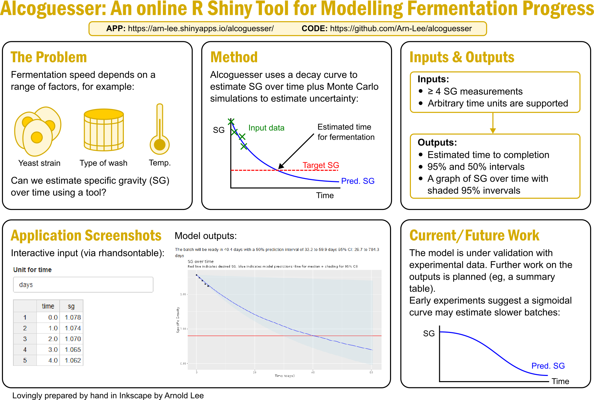

Alcoguesser
================
Arnold Lee

## Graphical abstract

## Introduction

This is a R Shiny application that assumes first-order kinetics and MC
simulations to predict when a fermentation batch is ready for bottling
or distillation. It is available online at
<https://arn-lee.shinyapps.io/alcoguesser/>

A full write-up will be available in the future (I’m currently waiting
for data collection).

Experimental branch: chose more realistic constraints for the nls port
algo and adding renv to lock down the environment. UI updates and
sigmoidal model are planned.
